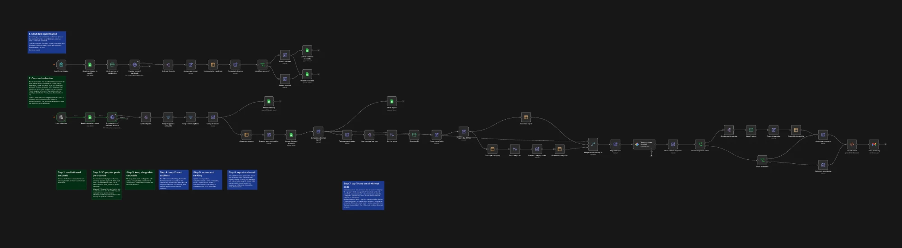

# n8n-eugenia — Projet de cours : « Veille carrousels TikTok Shop »

Ce dépôt contient le rendu du projet de cours n8n : le workflow, les skills Claude Code utilisés pour le construire et leurs grilles de travail.

**Vidéo de démonstration** (5 à 10 min) : (https://youtu.be/4cf_R_QiVnU)
**Transcript** : `docs/transcript-video.md` _(à ajouter une fois la vidéo finalisée)_

## Le projet en bref

Mon workflow repère des créateurs TikTok français qui vendent via des carrousels photo liés à TikTok Shop. Il classe leurs carrousels par vitesse et surperformance dans un Google Sheet, puis envoie un récapitulatif par email (top 10 et analyse rédigée par Gemini).



- **Qualification des candidats** (formulaire) : 1 crédit ScrapeCreators par candidat. Le compte devient « suivi » s'il publie assez de carrousels shoppables.
- **Collecte** (manuelle) : 30 posts populaires par compte suivi, filtre sur les carrousels shoppables puis sur les légendes en français, calcul des scores, mise à jour du classement, bilan et email.

## Contenu du dépôt

```
workflows/   le workflow n8n exporté en code (.workflow.ts)
skills/      les 3 skills Claude Code utilisés, avec leurs grilles et modèles
docs/        captures et transcript de la vidéo
```

| Skill | Rôle dans le projet | Compléments |
|---|---|---|
| [interview](skills/interview/SKILL.md) | Poser les questions jusqu'à zéro doute, puis écrire un brief validé avant de construire | [grille de couverture](skills/interview/coverage-grid.md), [modèle de brief](skills/interview/brief-template.md) |
| [doubt-driven-dev](skills/doubt-driven-dev/SKILL.md) | Construire en vérifiant chaque affirmation par un test PASS/FAIL, et chercher les briques existantes avant d'en créer | [table des preuves](skills/doubt-driven-dev/evidence-table.md), [checklist des briques existantes](skills/doubt-driven-dev/prior-art-checklist.md), [modèle de journal des doutes](skills/doubt-driven-dev/doubt-log-template.md) |
| [hostile-review](skills/hostile-review/SKILL.md) | Relire le travail fini avec un regard critique : chaque point vérifié, erreurs corrigées, verdict final | [grilles de relecture](skills/hostile-review/lenses.md), [modèle de revue](skills/hostile-review/review-template.md) |

## Standards du cours

| Standard | État |
|---|---|
| Cards qui expliquent le workflow | Notes sur le canevas : 1 par déclencheur et 1 par étape |
| Nœuds renommés | Oui, tous |
| Credentials renommés | ScrapeCreatorsAPI, GoogleSheetsAPI, GmailAPI. Le credential Gemini garde son nom par défaut (« Default Gemini Projet – … ») |
| Pas de nœud Code | Aucun. Nœuds natifs (Set, Filter, If, Sort, Limit, Summarize, Merge, HTML…) et expressions `{{ }}` |
| Pas de nœud HTTP sauf si indispensable | 2 nœuds HTTP Request, indispensables (voir ci-dessous) |

**Pourquoi 2 nœuds HTTP Request ?** Les nœuds « Posts populaires du candidat » et « Posts populaires du compte suivi » appellent l'API ScrapeCreators, qui n'a pas de nœud natif dans n8n. Le nœud HTTP Request est donc le seul moyen de l'appeler. La clé API n'est pas dans le workflow : elle est stockée dans un credential d'en-tête (`x-api-key`). La pagination (`max_cursor`) utilise l'option native du nœud HTTP, sans code. La card « Étape 2 » du canevas le rappelle.

## Importer et tester avec n8n-cli

```bash
n8ncli validate "workflows/Veille carrousels TikTok Shop.workflow.ts"
```

```bash
n8ncli test "workflows/Veille carrousels TikTok Shop.workflow.ts" --pin-data <données-simulées.json> --trigger "Lancer la collecte"
```

`n8ncli test` exécute le workflow avec les sorties de nœuds fournies dans le fichier JSON (par exemple les réponses d'une vraie collecte). Les nœuds simulés n'appellent pas l'API : 0 crédit ScrapeCreators.
